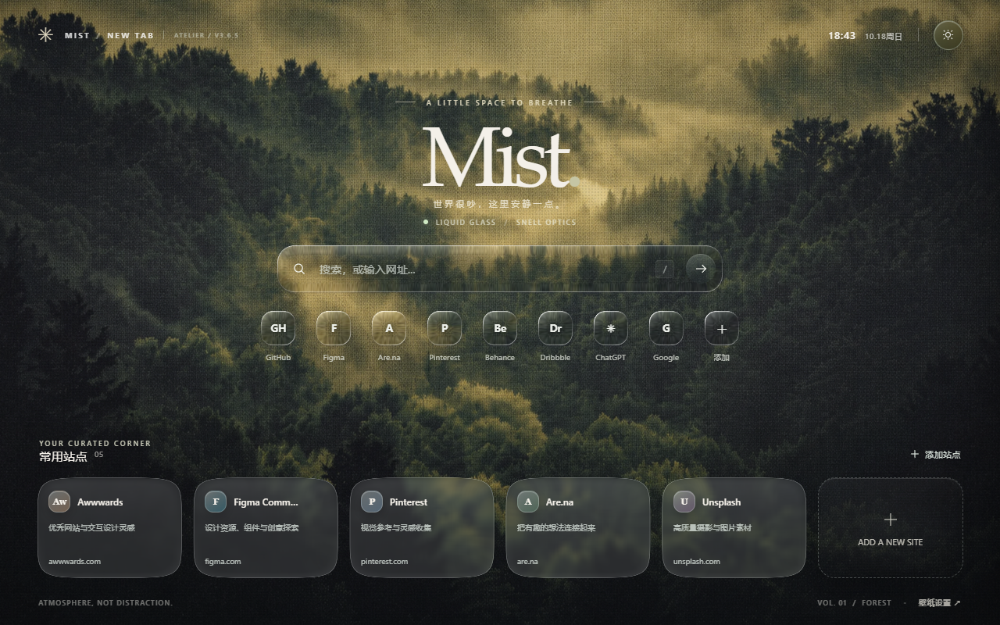
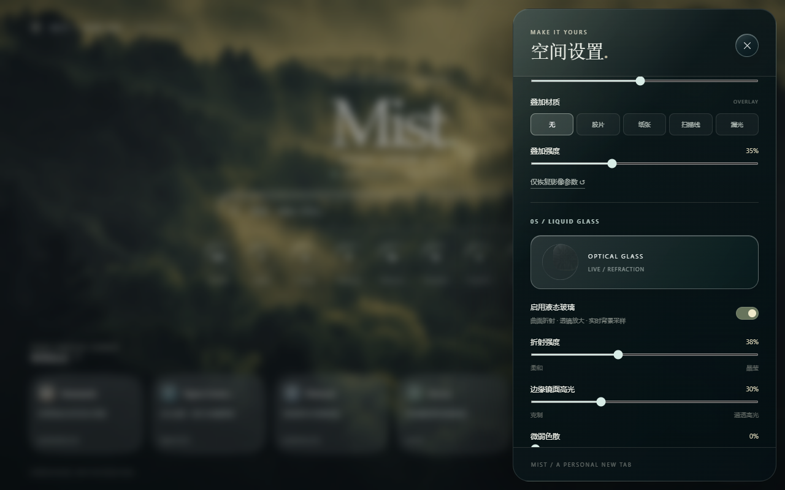

[中文](README.md) | **English**

# MIST 3.6.5 — Liquid Glass performance update

A Chrome / Edge Manifest V3 new-tab extension, preserving the layout and glass style of MIST 3.3.1.

A misty forest background with a liquid glass search field, editable website shortcuts and bookmark cards, local wallpapers, and appearance controls.

## Project information

- Version `3.6.5`; no build step or third-party JavaScript dependencies.
- [Changelog](CHANGELOG.md), [Privacy](PRIVACY.md), and [MIT license](LICENSE).
- Report issues with browser version and reproduction steps; attach screenshots when useful.
- Microsoft Edge Add-ons submission materials are being prepared. Install locally as described below.
- Screenshots show the extension running in a browser. This repository does not provide a hosted web demo.

## Install

Download and extract the repository ZIP. Open `edge://extensions` in Edge or `chrome://extensions` in Chrome, enable Developer mode, and choose **Load unpacked**. Select the directory containing `manifest.json`, then open a new tab.

## Features

- Eight image presets: Original, Cinema, Monochrome, Cool Mist, Old Film, Midnight, Paper Archive, and Soft Light.
- Contrast, saturation, temperature, mist, and vignette controls.
- Adjustable film grain, paper, scanline, and light-leak textures.
- Upload a wallpaper; edits are non-destructive and stored locally.
- Refraction uses a shared WebGL2 canvas and workers.

## Preserve existing settings

The storage key remains `mist-tab-state-v1`. To keep the same extension ID and settings, replace the contents of the existing installation directory and reload the extension. Installing from a different directory can generate a different ID; settings do not migrate automatically. Back up first.

## Glass and slow drift

Search and shortcut controls use curved refraction calibrated against Outpace: refractive index 1.5, smooth corners, edge bending, and directional highlights. Bookmark cards use a Bubbbly-inspired sixth-power lens, internal magnification, 9×9 background softening, and light or dark tinting.

Strength, highlight, and dispersion controls remain available. Visible glass regions share one GPU canvas. During slow drift, the image inside each lens follows the background. Text and controls remain separate from the displaced image. The settings sample uses the same live refraction.

References: [Outpace](https://glass.outpacestudios.com/) and [Bubbbly](https://www.bubbbly.com/app/github-glass-badge.html). One worker creates the background raster and displacement maps; another handles WebGL2 initialization, texture upload, and drawing through OffscreenCanvas. Directional rims use SVG paths rather than a separate SVG displacement filter for every control.

## Performance and fallbacks

- Sixteen lenses share background textures instead of keeping full background copies.
- The 9×9 mean filter is separated into horizontal and vertical nine-sample passes.
- Strength changes update shader parameters immediately. Geometry maps are coalesced and cached 100ms after input stops.
- Static scenes redraw only when content or position changes. Slow drift is capped at 60 redraws per second; background tabs pause.
- Worker drawing keeps at most one active frame and one pending latest frame.
- Without WebGL2, controls fall back to native frosted glass. Reduced motion and reduced transparency are supported.

Performance depends on GPU, browser, and viewport. Frame-callback timing is not the same as displayed frame rate; no fixed frame rate is guaranteed on every device.

## After updating

Reload MIST in the extension manager, then refresh or reopen existing new tabs. `ATELIER / V3.6.5` at the top left identifies this version; old tabs may still be running earlier scripts.
